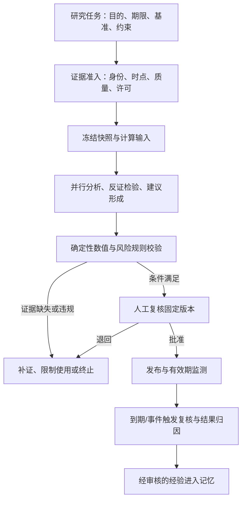

# TradingAgents 金融研究生产化优化建议书

版本：`OPT-1.0`；日期：2026-10-24；评估代码：本地提交 `9dd5b06`，来源为上游 `0.7.0 / e8f5503`。

性质：基于代码与现有文档的业务及技术建议，供产品、研究、风控、工程与运维共同评审。本文件提出优先级和范围调整，不代表方案已获批准或功能已实现。所有容量、周期与质量阈值均为建议值，需基线测量后确认。

## 1. 核心判断与投资顺序

当前系统已具备可复用的多智能体研究核心和较完整的工程回归基础。下一阶段的主要投入应放在“输入和证据可验证、研究结论可复核、风险约束可执行、结果可追踪”上。Agent数量、辩论轮数、报告篇幅不能作为研究质量的替代指标。

建议第一产品定位为**面向内部研究人员的、可审计的低频金融研究工作台**。先选一个市场、一种研究用途、一套明确评估期限；例如批准标的范围内的收盘后个股研究。股票、ETF、crypto分别设计研究模板，跨市场逐项验收。订单、成交和资金账本继续作为独立后续项目。

近期优先顺序：

1. 定义研究任务、评级、期限、证据与不予判断的业务契约。
2. 建立最小证据快照、实验隔离、数值校验和报告复核闭环。
3. 完成异步任务、权限、预算、审计、监控和恢复。
4. 用真实前瞻样本比较现有多智能体方案与简单基线，再决定扩展投入。

### 1.1 基于当前代码的具体判断

| 已确认事实 | 金融业务含义 | 优化方向 |
|---|---|---|
| [决策schema](../../src/tradingagents/agents/schemas.py)的 `time_horizon` 为可选文本，默认[结算周期](../../src/tradingagents/default_config.py)为5个交易日 | 长周期投资论点与短期收益观察可能不可比 | 将研究期限和评估窗口结构化、版本化 |
| [结算](../../src/tradingagents/memory/settlement.py)计算标的收益减基准收益，[回测](../../src/tradingagents/backtest.py)按评级方向统计 | 目前是简单超额收益，不是因子调整alpha，也不是含成本组合净值 | 规范命名、基准和统计用途 |
| [持仓](../../src/tradingagents/portfolio.py)主要包含数量、成本、现金与币种文本 | 还不足以计算可靠的组合风险和可执行仓位 | 增加估值时点、账户约束、FX与确定性计算 |
| [研究经理及组合经理schema](../../src/tradingagents/agents/schemas.py)鼓励选择更强的一方，情绪置信度来自模型自评 | 表达坚定不代表概率校准；观点分歧可能反映证据不足 | 单列证据质量、论点状态、情景与不予判断 |
| [图构建](../../src/tradingagents/graph/setup.py)中多数角色共享quick模型，经理共享deep模型 | 多角色不等于统计独立，多轮可能重复同一来源的偏差 | 来源去重、反证校验、消融试验与成本比较 |
| [记忆](../../src/tradingagents/memory/log.py)按ticker/date去重，按同标的与最近跨标的记录取上下文 | 实验可能互相抑制，跨行业/市场经验未必可迁移 | 工作空间/实验隔离和按适用范围检索 |
| [反思](../../src/tradingagents/memory/reflection.py)已提醒短周期不能否定长期论点，但主要输入为原决策及收益 | 已有谨慎提示，仍缺少催化剂兑现、因子归因等证据 | 将结果观察与因果解释分开存储、复核 |
| [日期工具](../../src/tradingagents/dataflows/date_window.py)主要以日期为入口，部分朴素时间按UTC处理 | 多市场盘前、盘后、夏令时需要明确的决策时点契约 | 建立市场日历、带时区cutoff及迟到数据规则 |
| [既有验证记录](../04-testing/validation-report.md)显示1361项测试、100项子测试通过 | 证明已测工程行为；不能据此判断模型质量、金融有效性或生产可用性 | 增加真实契约、金融边界、前瞻观察和运行演练 |

上述问题是能力差距和业务设计风险，不等于已经证实存在投资损失、违规行为或特定数据泄漏。

### 1.2 对现有方案的优先级修订

现有[需求](../01-requirements/product-requirements.md)和[开发计划](../03-development/implementation-plan.md)将完整证据快照与记忆隔离放在S2。建议拆成“试运行必需最小能力”和“后续规模化能力”，避免S1生成无法追溯或实验互相影响的研究报告。

| 现有规划 | 建议修订 | 理由 |
|---|---|---|
| FR-004 / DEV-070主要在S2 | S1保留本次使用的证据、时间、hash、许可信息；S2建设历史档案和批量重放 | 报告复核在第一天就需要原始依据 |
| FR-008 / DEV-080主要在S2 | S1完成工作空间/实验隔离；S2做集中记忆和遗留迁移 | 隔离是试验可信性的前置条件 |
| FR-003 / FR-005强调评级与持仓输入 | 补充期限、基准、数值和适用性契约；新增独立规则校验工作包 | LLM风险辩论不能承担确定性约束 |
| FR-006 / FR-009报告与复核 | 增加论点失效、到期复核、撤回和修订关系 | 报告发布后仍有生命周期 |
| FR-007主要做网格回测 | 优先建立同条件基线比较与前瞻影子运行，再扩大历史网格 | 降低事后知识和选择性呈现影响 |
| NFR-001主要监测API可用性 | 加上“在业务截止时间前交付可复核报告”的业务SLI | HTTP成功与业务可用之间仍有距离 |

这些修订应经过评审后同步PRD、追踪矩阵、开发任务和验收清单；此处不新增未经评审的正式FR编号。

## 2. 业务流程：让每份研究建议有边界、有依据、有生命周期

### 2.1 研究任务契约

在ticker和日期之外，要求任务明确：研究用途、标的唯一身份、市场/资产类型、决策时点、预测期限、报告有效期、比较基准、计价币种、允许的数据源及配置版本。涉及账户建议时，另冻结持仓与投资约束版本。

区分三个时间概念：**观察窗口**用于读取过去数据，**预测期限**说明观点针对未来多久，**有效期**说明多久后或何种事件后必须重新判断。报告写“中长期看好”而评估用5日收益，只能记作中间观察，不能直接定性为论点成功或失败。

建立研究任务模板：财报事件、估值研究、趋势观察、持仓复核分别指定必需证据和适用模型。ETF需额外覆盖跟踪标的、费用、折溢价、持仓及流动性；不能直接套用公司财务模板。非支持场景返回明确原因。

### 2.2 建议的业务闭环

任务运行状态、证据质量状态、报告复核状态分别管理。建议新增的 `insufficient_data`、`stale`、`conflicted`、`out_of_scope` 是平台质量状态；不要直接改现有五档评级以破坏兼容。保留 `REVIEW` 处理不可解析输出，并通过显式映射展现质量和复核原因。

### 2.3 评级与建议分层

将以下内容分开记录：研究观点、支撑/反对证据、情景假设、评级、账户适用性、行动建议。没有账户信息时只能给出一般研究观点；不知道风险限额或估值时点时，不生成看似精确的可执行仓位。

明确每档评级相对于什么基准、哪个期限、什么投资约束；不要跨策略使用同一套固定收益阈值。`Overweight`需要说明相对基准或目标配置，`Sell`在只做多账户中不自动等于允许开空仓。绝对收益和相对表现可以方向相反，应同时展示。

研究报告以“摘要、关键事实、论点与反证、情景、催化剂、失效条件、数据限制、适用范围、复核记录”为标准结构。目标价必须带估值方法和关键假设；证据不足时允许不给目标价。

### 2.4 复核和例外处置

研究负责人对固定版本复核，权限规则与硬性风险限制不能由LLM或普通复核按钮绕过。业务可豁免规则必须预先定义审批角色、有效期、理由和影响；不可豁免规则需要修正输入或撤销建议。

财报、停牌、重大公告、价格偏离阈值、来源修订或有效期到期可触发重新研究。撤回与修订建立新版本关系；原始报告和已分发范围保留。首期可由人工登记事件触发，成熟后自动化。

## 3. 技术方案：补足金融数据与决策控制层

### 3.1 在现有架构上增加清晰边界

沿用模块化单体、独立worker、PostgreSQL和对象存储的方向；先落实任务/证据/规则/报告边界，暂不因Agent多而拆成大量微服务。队列采用团队已有可靠托管服务，消息重复交付由数据库领取、租约和结果条件提交处理。

建议的六类核心对象：`ResearchMandate`、`EvidenceBundle`、`CalculationResult`、`ResearchDecision`、`PolicyCheck`、`ReportVersion`。这些是目标契约，尚无对应实现。每个对象都能追溯任务、代码、配置、市场、时间和来源。

### 3.2 证券主数据与时点体系

证券主数据使用稳定instrument_id，映射ticker、交易所、上市实体、币种、最小报价单位、公司行动及历史有效区间。代码更名、同代码不同市场、ADR与普通股不得仅靠字符串等同。账户/委托相关规则按市场及账户类型版本化。

数据至少保留event_time、published_at/known_at、fetched_at、valid_from/to和系统记录版本。历史重建与实际实时运行分开：前者使用当时已公开、且拥有可靠历史档案的数据；后者必须证明系统在决策前已取得该数据。缺乏历史披露时间不能靠今天的抓取时间补造。

冻结明确的带时区cutoff；盘后披露不能用于盘前决策，夏令时、半日市、跨时区行情需回归验证。复权规则、现金分红、拆并股、退市及基准成分变化必须记录，避免幸存者偏差和公司行动造成的假收益。

### 3.3 证据与数值计算分离

价格、收益、估值倍数、仓位、汇率转换、集中度与压力情景由可测试代码计算；LLM解释计算结果、提出假设与反证。计算对象包含公式、输入、单位、时点、缺失处理和版本，报告中的数字引用计算对象。

引用精确到文档版本/段落/表格单元，不只保留URL。转载新闻去重，同一事件多个来源不当作多份独立证据。关键数字不一致时呈现冲突来源和裁决规则，不让多数Agent投票决定哪个价格是真的。

数值和政策校验至少覆盖：有限值/正负号、币种和单位、陈旧价格、仓位计算、只做多限制、研究池准入、账户集中度以及必要证据。机构阈值由账户授权确定；数据不足时返回“无法计算/无法校验”，不得显示为低风险。

本期规则用于约束研究建议与报告发布；券商下单前的限额、订单、成交及资金风控仍属独立后续系统，不能用这组研究检查代替。

### 3.4 多智能体成本与模型风险

用证据来源和论证职责区分角色，而不是仅改变“看多/看空”的口吻。要求每个重要结论关联证据、关键假设及可推翻条件；外部反证检验器检查是否遗漏或误用证据，确定性校验器核对数值。

比较单Agent、现有多Agent、减少轮数、移除某分析师、关闭记忆等消融方案。在相同数据和可比成本预算下测量质量、分歧、延迟和费用，保留有增量价值的步骤。跨模型只用于高影响或争议样本，并测量错误相关性；不同供应商也不能被假定完全独立。

模型自评的“高置信度”和0–10情绪分数不等于胜率。只有定义预测事件、拥有足够带标签样本并完成校准，才展示概率；否则展示证据质量和情景敏感性。

### 3.5 记忆与复盘

将事实结果、收益归因、催化剂进展、模型生成经验和人工认可经验分别存储。历史收益好坏不是论证因果正确的充分条件。先核实事实，再决定哪些经验可以影响后续研究；按策略、市场、行业、期限、模型版本和当时可知状态检索。

当前记忆结算与分析师一起执行且进入汇合点，积压较大时可能拖慢新任务。建议把收益结算和反思移为有独立预算的后台作业，研究开始时冻结可用记忆版本；如业务需要最新结算，可设置有限等待。这样能分离前台研究成本与历史维护成本。

### 3.6 一致性、隐私与供应商管理

快照、记忆、checkpoint及结果按工作空间、实验、任务和attempt隔离；对象写入、任务终态和审计引用做一致性核验。恢复同时验证代码/prompt/schema/配置/证据版本；不同版本结果不能悄悄拼接。

已有显式vendor链值得保留。供应商切换涉及复权、字段和时间语义，应新建可追踪的数据版本，不能只以“有响应”作为替代成功。行情使用权限、模型内容处理条款、公司保密范围、来源许可和保存期限按实际机构与地区确定；现有365天/90天等值不能直接当作通用金融行业法定期限。

## 4. 系统开发：按可验收的业务闭环交付

### 4.1 建议的开发增量

| 增量 | 复用/修改位置 | 主要交付 | 依赖与验收 |
|---|---|---|---|
| A. 研究契约 | agents/schemas、portfolio、application/domain适配层 | 期限、基准、instrument、状态、版本契约 | 非法组合在发模型调用前拒绝 |
| B. 最小证据与实验隔离 | dataflows、memory、graph adapter | 快照manifest、引用ID、实验路径、输入hash | 同一ticker/date不同实验互不覆盖，关键数字可复算 |
| C. 数值/政策检查 | 新的计算与policy模块 | 准入、单位、期限、仓位、缺失/冲突规则 | 硬性规则对恶意/错误模型输出仍然生效 |
| D. 异步任务与发布闭环 | interfaces/api、application、infrastructure | 任务、租约、预算、权限、报告复核、审计 | 故障重试只有一个被接受结果，原报告不可改写 |
| E. 评估及运营 | backtest adapter、评估服务 | 基线/消融、前瞻观察、质量反馈、成本归因 | 相同样本和口径可比较，失败/未评分完整统计 |
| F. 集中化和扩展 | 存储/队列/观测基础设施 | 长期历史档案、集中checkpoint、容量扩展 | 负载、恢复、隔离和生命周期演练通过 |

这些是工作分解建议，并非已有目录或服务；应映射到既有DEV任务，给数值/政策检查及研究期限契约补充专门任务。

### 4.2 工程实施规则

保留既有SDK与CLI导入接口，通过adapter渐进引入新契约；旧自由文本schema到新字段的迁移须记录未知值，不能猜填预测期限或历史披露日期。新增状态与现有REVIEW之间定义兼容映射。

优先交付“一个批准标的任务→固定证据→分析→规则检查→复核→归档”的纵向闭环，再扩市场/模型。每个增量包括失败、取消、权限、审计、预算、文档和运行证据。

数据库变更先兼容扩展再回填，迁移做dry-run、条目数/hash/金额核对，保留旧数据。应用版本、依赖锁、prompt/schema、策略和数据版本形成可定位的发布组合。锁定生产镜像摘要及构建工具，避免只锁Python依赖仍出现环境漂移。

资金/费用持久层使用decimal，浮点分析明确容差；数值API拒绝NaN/Infinity和单位缺失。图实例按任务独立，取消或超时不允许把已消耗的模型费用清零。

## 5. 功能测试与金融有效性验证

### 5.1 在已有离线测试上增加金融场景矩阵

| 场景 | 应验证的结果 | 层次 |
|---|---|---|
| 财报在决策时点后披露、后续重述 | 决策输入只包含当时已知版本；未知披露时间显式缺失 | 数据/系统 |
| 纽约盘后、香港交易日、夏令时、半日市 | cutoff、行情可用性、评分窗口不跨越错误边界 | 数据/系统 |
| 拆股、现金分红、更名、退市、历史指数成分 | 身份连续、收益口径一致、退市样本不消失 | 金融数据 |
| 缺失/过期价格、报价币种不一致、成交量异常 | 不虚构计算结果，按政策阻断或限制报告用途 | 规则/验收 |
| 无持仓、明确空仓、多头/空头、重复标的、NaN | 语义明确；错误或歧义输入在模型调用前处理 | 输入/规则 |
| 3个月论点与5日观察 | 中间观察不记作最终论点失败，评估窗口明确 | 评估 |
| 只做多账户收到Sell、Overweight无基准 | 不映射成无授权开空/任意加仓；缺少定义则复核 | 规则/验收 |
| 新闻注入、伪造引用、多个转载来源 | 不改变工具权限；引用核验失败和来源重复可见 | 安全/模型 |
| 同ticker/date不同模型、乱序回测、重复任务 | 实验隔离；历史记忆不取未来经验；幂等生效 | 系统 |
| 上传成功但DB失败、过期worker提交、取消竞争 | 只有有效attempt可接受；对象可追踪，费用保留 | 故障注入 |
| 密钥轮换、供应商429、模型退役、额度耗尽 | 有界重试、明确终态、备用版本可追踪 | 契约/运行 |
| 更正/撤回已发布报告、未授权访问 | 固定版本审计完整，权限不可绕过，分发范围可定位 | 验收 |

硬性准入、权限、时间边界和数据一致性用确定性断言；自然语言内容用事实核对、结构规则、人工盲审和统计评估，不能依赖字符串完全相等。

### 5.2 评估口径需要升级

当前 `alpha = 标的收益 - 基准收益`建议在界面称为“相对基准超额收益”，保留字段兼容，并说明其不是风险调整后的回归alpha。标的与基准需同币种、同观察窗口、明确价格/总回报口径；不同地区指数的分红处理不能默认相同。

独立决策样本不能直接拼接成策略净值或计算可解释的策略Sharpe。只有另建持仓演化、现金、成交、费用、借券、滑点与公司行动账本后，才评价可执行组合绩效。

区分绝对方向命中与相对基准方向命中。展示数量、分布、置信区间、未结算、失败、REVIEW及未评分；多空、市场、期限分层报告。观察窗口重叠的样本不是独立试验，可采用时间块/标的聚类等方法估计不确定性。候选模型和参数反复比较需登记试验次数并保留最终未触碰评估集。

### 5.3 历史回测不能排除模型自身的事后知识

工具的数据时点过滤无法消除LLM参数中可能存在的历史事件结果。不能因为新闻/财报过滤正确就声称历史回测完全无前视偏差。记录供应商模型版本及已知训练信息，无法核验时明确unknown；去标识实验能帮助诊断，不能证明已消除污染。

将**前瞻影子运行**作为增量价值的重要证据：在结果发生前固定输入、配置与建议，按约定期限结算，期间只记录修订版本，不更换原始预测。影子运行不下单，也不能代替真实成交成本研究。

### 5.4 建议的试验和放行标准

建立单Agent、当前多Agent和简单规则/人工研究流程的对照；固定样本、信息可用性、输出用途及可比预算。人工评审尽量隐藏模型身份，评审分歧需裁决。先验证事实与效率，再讨论预测增益。

初始建议：确定性硬规则关键用例100%通过；所有正式试运行报告的关键数值100%关联计算证据或明确缺失；已发布报告均有复核及版本记录。事实正确率、有效完成率、成本和耗时用首轮样本建立基线，不采用未经验证的统一95%或10%提升作为行业标准。观察期达到约定期限且样本足够后再判断统计效果，90天不保证能评估长期策略。

## 6. 运营：围绕研究价值和可控成本建立闭环

### 6.1 运营对象与内容

首期建议5–10名具备复核能力的内部研究用户，10–20个批准标的作为候选规模；由实际研究频率、数据覆盖和预算调整。运营管理研究模板、准入范围、用户角色、证据质量、复核积压、到期报告、来源变更和反馈问题。

培训用真实边界案例：没有数据与负面数据不同、评级与交易指令不同、模型置信度不是概率、短期涨跌不等于长期逻辑正确。对外分发或转为面向客户建议时，另评估业务资质、适当性、利益冲突、审阅与留痕要求，不能沿用内部试用规则自动开放。

### 6.2 指标与成本口径

| 指标 | 建议定义 | 使用方式 |
|---|---|---|
| 业务按时完成率 | 截止时间前提供满足证据/规则条件的报告任务 ÷ 当期应交付任务 | 技术生成和人工复核时效分别披露；取消/拒绝不能悄悄从分母消失 |
| 关键事实可追溯率 | 有有效证据/计算引用的关键事实数 ÷ 应有引用的关键事实数 | 与正确率同时看，有引用不代表引用支持结论 |
| 重大事实纠正率 | 有重大事实更正的报告数 ÷ 已完成复核的报告数 | 按数据/模型/计算/时间/身份分类 |
| 研究效率 | 同任务类别的检索、核验、修改与复核总时长 | 与人工基线比较，计入修正成本 |
| 单份有效报告全成本 | 模型、数据、基础设施、人工复核及失败重试分摊 ÷ 有效报告数 | unknown账单单列；资本化开发费用另报 |
| 人工推翻率 | 被复核人改判或退回的建议数 ÷ 已复核建议数 | 分析原因，不作为压低人工否决的绩效指标 |
| 质量事件关闭率 | 有根因、修复版本及回归证据的已关闭事件 ÷ 到期应关闭事件 | 跟踪复发率及逾期 |

业务价值可用“节省并验证的研究工时×单位工时成本−新增运行与复核成本”作第一阶段估算，同时呈现质量变化。报告数量、Buy比例、表面胜率或降低REVIEW率不应成为孤立激励。

### 6.3 运营节奏与职责

每日：来源异常、应交付任务、费用、REVIEW/数据缺失、复核积压、失效/撤回报告。每周：抽样盲审、来源质量、模型差异、纠正案例、模板效果。每月：模型/数据费用对账、授权清理、市场准入、来源许可、价值评估和灾备演练结果。

研究负责人对输出用途和复核负责，独立风控/模型验证人员对限制和有效性负责，工程对系统正确性负责，运营对采用与反馈闭环负责，SRE对交付时效和恢复负责。小团队可兼任，但不能由同一模型给自身评分并自动批准发布。

## 7. 运维：同时保障服务、数据和研究流程

### 7.1 三层健康度

技术层观察API、队列、worker、DB、对象存储；数据层观察价格/新闻时效、完整性、冲突、身份映射、供应商覆盖；业务层观察按时交付、可复核性、评级异常分布、预算与待复核积压。

现有99.5% API可用性仅适合作为候选技术SLO。核心业务SLI应是“在批准的研究时间窗内交付可复核报告”。股市节假日、盘后批次、供应商修订时间与crypto全天候服务需分别定义；不把正常闭市当数据源故障。

### 7.2 分级降级与停止策略

情绪/辅助新闻缺失是否允许报告继续，应按研究模板决定；若任务就是舆情事件研究，该来源不是可随意缺省的辅助项。关键价格、币种、身份或披露时点无法确认时，停止相应数值建议或整份报告发布。

供应商切换仅使用已批准且语义兼容的来源。停止新任务、取消后续模型调用、冻结报告发布分别提供控制开关，并记录操作者、范围与恢复条件。恢复任务采用原冻结版本或明确新建任务，不静默混合旧证据与新模型。

### 7.3 备份恢复与对账

除数据库和报告外，备份版本清单、证据引用、任务状态、审计、费用账本和恢复所需secret引用；实际secret按组织机制管理。单机SQLite备份必须一致，集群使用集中状态。

恢复验证包括：任务有无丢失、报告/对象hash是否对应、审计连续性、权限是否恢复、费用是否重复、过期worker能否提交、恢复前后输入版本是否一致。队列恢复应以任务/outbox真相重建。

已有RPO24小时/RTO4小时只作为单机试运行候选目标；活跃任务和审计的可接受丢失量需单独决定。后续RPO15分钟/RTO1小时应靠真实演练测量，不能用“备份作业成功”代替业务可恢复。

### 7.4 告警与业务连续性

按task/attempt、供应商、模型/策略版本关联日志，避免把用户/ticker做高基数指标。大面积缺失、评级分布突变、同一关键数字异常、费用unknown积压应进入质量告警；市场剧烈变化也会改变分布，需业务核验后判断漂移。

备用模型需预先完成schema、工具、质量、费用和延迟验证；主模型故障时替换不是单纯基础设施切换。财报季与市场异常日进行限额/并发压力演练，优先保障关键复核任务，控制历史回测与反思后台作业。

## 8. 优先级、责任人与验收

P0：进入受控业务使用之前需要具备；P1：试运行后提升效果与规模；P2：有明确效益证据再建设。下表的OPT编号仅标识本建议书，不代替正式需求ID。

| 建议 | 优先级 | 交付与价值 | 牵头 / 协作 | 验收证据 |
|---|---|---|---|---|
| OPT-01 研究任务、评级和期限契约 | P0 | 使建议可比较、用途清楚 | 产品/研究 + 核心开发 | 同一任务的期限/基准/币种贯穿报告与评估 |
| OPT-02 最小证据快照与引用 | P0 | 能解释每个关键事实从何而来 | 数据 + 后端/QA | 关键数值100%可复算或明确缺失 |
| OPT-03 身份、时区、公司行动 | P0最小范围，P1扩市场 | 防止错公司、错日期和假收益 | 数据 + 金融QA | 首批市场边界和公司行动用例通过 |
| OPT-04 确定性数值/风险规则 | P0 | 使硬限制可执行 | 风控 + 核心开发 | 模型给错误建议仍被规则阻断；未知风险不当作通过 |
| OPT-05 实验/任务/记忆隔离 | P0 | 结果互不污染、恢复可追踪 | 后端 + 核心开发 | 同ticker/date多实验和故障恢复测试通过 |
| OPT-06 固定版本复核与有效期 | P0 | 明确使用责任和失效处置 | 研究 + 产品/后端 | 复核、撤回、修订链和分发审计可查询 |
| OPT-07 异步任务、权限、预算 | P0 | 可控地服务多个研究用户 | 后端 + 安全/SRE | 幂等、越权、租约、deadline及费用测试通过 |
| OPT-08 基线与前瞻影子运行 | P0试验方案，P1扩样本 | 证明真实增量价值 | 模型验证 + 研究/QA | 预先登记样本/口径，完整保留失败与未评分 |
| OPT-09 记忆治理与后台结算 | P1 | 减少事后叙事和前台延迟 | 模型/数据 + 核心开发 | 经验有来源/期限/适用范围，前台不等待无界积压 |
| OPT-10 运营质量与全成本 | P0最小登记，P1自动化 | 明确采用效果和投入产出 | 运营 + 财务/研究 | 按统一分母、人工工时和账单对账输出周报 |
| OPT-11 业务SLO和恢复演练 | P0 | 保证报告能按时、正确恢复 | SRE + 数据/QA | 截止时间、降级、恢复、审计和费用核验记录 |
| OPT-12 高级组合分析/订单系统 | P2独立立项 | 按业务价值扩展 | 产品/风控 + 交易工程 | 先定义资金/成交/持仓对账及确定性风险门禁 |

## 9. 建议的90天行动路线

假设已有可用身份/基础设施、许可数据及专职研究负责人，工程、数据/模型验证、QA与SRE资源可参与。以下是排程框架，不是交付承诺；采购、资质或数据许可未解决时先缩小试验范围。

| 时段 | 主要工作 | 阶段出口 |
|---|---|---|
| 第1–2周 | 选定市场/用途/期限；确定任务、评级、证据、风险契约；建立人工与单Agent基线、评估语料 | 业务口径、数据许可、负责人、预算和试验方案明确 |
| 第3–4周 | 单标的闭环：快照/隔离/数值规则/固定版本复核；最小权限、审计、预算和监控 | 关键金融边界、权限与一致性用例通过，可进入受控样本验证 |
| 第5–8周 | 持久异步任务、故障恢复、运营登记；开始前瞻影子运行与消融比较 | 有真实质量/时效/成本证据，严重缺陷关闭；完成恢复演练 |
| 第9–12周 | 按已成熟样本评估增量价值，改善高成本/低质量节点；决定是否扩大用户/标的 | 以质量、全成本和按时交付决定扩容、保留或收缩方案 |

预测期限超过观察期的样本继续pending，不能为了90天里程碑提前宣布收益有效。影子运行通过也不自动进入实盘；订单系统需要另外的产品和金融控制门禁。

## 10. 建议首先形成的五份可评审成果

1. 研究任务与评级语义字典：市场、期限、基准、币种、失效条件及不予判断规则。
2. 首批数据源与证据规范：身份/披露时间、历史覆盖、许可、快照与计算引用。
3. 数值和风险规则清单：输入、公式、阈值来源、缺失行为、例外权限与测试案例。
4. 单Agent/多Agent/人工基线试验方案：固定样本、预算、事实核验、效率及前瞻观察。
5. 受控试运行准入记录：任务/权限/预算/审计/恢复、责任人及可接受风险。

相关材料：[现状分析](project-analysis.md)、[需求](../01-requirements/product-requirements.md)、[总体架构](../02-architecture/system-design.md)、[测试策略](../04-testing/test-strategy.md)、[运营方案](../05-operations/product-operations.md)、[恢复手册](../06-runbooks/backup-recovery.md)。
