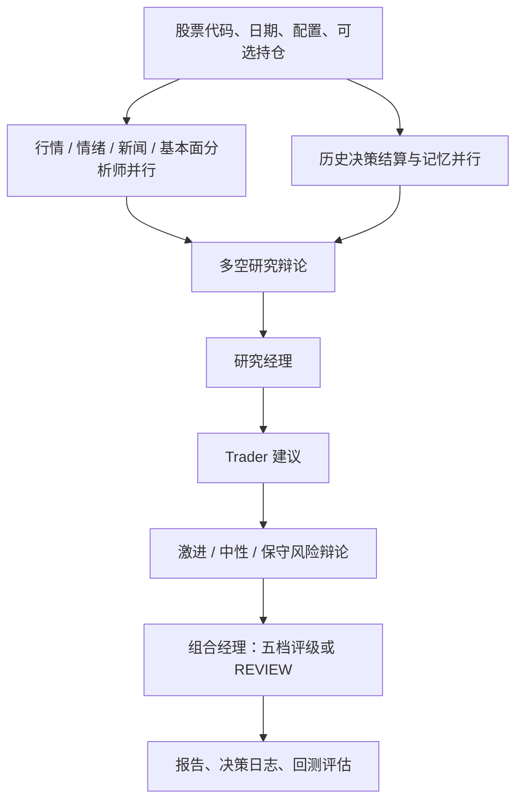

# 项目分析：能力、架构与生产差距

基线：2026-10-23，`jelven007/TradingAgents main@e8f5503`，包版本 `0.7.0`。结论基于拉取代码，未调用付费模型或真实行情验证。本次不进行交易效果背书。

## 1. 定位与技术组成

项目是 Python 多智能体金融研究框架。LangGraph 组织状态与节点，LangChain 连接模型及工具，Pydantic 约束结构化输出；Typer、Rich、Questionary 提供 CLI；Pandas、Stockstats 处理行情；Requests、yfinance 访问外部数据；SQLite 与 Markdown 文件持久化状态。

适合复用的核心是分析图、时点处理、供应商抽象和离线回归测试。生产系统需要围绕核心增加服务、数据与治理层，不必重新编写每个分析师。

## 2. 真实运行链路

所有选定分析师和记忆节点结束后才进入研究辩论，组合经理消费历史经验。并行化不会把分析师工具消息混入其他分析师上下文。决策评级不是订单；`REVIEW` 也不是 `Hold`。

## 3. 能力与代码证据

| 能力 | 当前情况 | 实现证据 |
|---|---|---|
| CLI、SDK | 已实现交互及无交互分析、回测、登录命令 | [CLI](../../src/cli/main.py)、[分析图](../../src/tradingagents/graph/trading_graph.py) |
| 智能体编排 | 四类分析师并行，多空及风险辩论，深浅模型分层 | [图构建](../../src/tradingagents/graph/setup.py)、[分析计划](../../src/tradingagents/graph/analyst_execution.py) |
| 结构化建议 | 研究计划、交易建议、组合决策、情绪报告 schema | [输出模型](../../src/tradingagents/agents/schemas.py)、[评级解析](../../src/tradingagents/agents/rating.py) |
| 数据访问 | 显式供应商链、工具级覆盖、分类错误与不可用提示 | [数据路由](../../src/tradingagents/dataflows/router.py)、[错误](../../src/tradingagents/dataflows/errors.py) |
| 时点处理 | 日期边界、SEC filed 时间、历史记忆可知时间等已有保护 | [日期窗口](../../src/tradingagents/dataflows/date_window.py)、[SEC](../../src/tradingagents/dataflows/vendors/sec_edgar.py) |
| 外部数据 | Yahoo、Alpha Vantage、SEC、FRED、Polymarket、Reddit、Stocktwits；各来源覆盖不同 | [供应商](../../src/tradingagents/dataflows/vendors/) |
| 模型接入 | 多家供应商、兼容端点、本地模型，深浅层可分别配置 | [工厂](../../src/tradingagents/llm_clients/factory.py)、[模型能力](../../src/tradingagents/llm_clients/capabilities.py) |
| 报告 | 分节 Markdown、整合 Markdown/HTML、配置摘要 | [报告写入](../../src/tradingagents/reporting.py)、[HTML](../../src/tradingagents/report_html.py) |
| 记忆与恢复 | 文件锁、决策去重、历史结算、可选 SQLite checkpoint | [记忆](../../src/tradingagents/memory/log.py)、[checkpoint](../../src/tradingagents/graph/checkpointer.py) |
| 决策回测 | ticker × date 网格、独立日志、断点继续、按评级算超额收益 | [回测](../../src/tradingagents/backtest.py)、[结算](../../src/tradingagents/memory/settlement.py) |
| 工程保障 | 离线默认测试、供应商模拟、CI、wheel 发布、非 root 容器 | [测试](../../tests/)、[CI](../../.github/workflows/ci.yml) |

## 4. 关键语义与限制

- 数据日期与可知日期不同。历史财务数据需在分析日之前披露；非美国 Yahoo 报表缺乏披露时间，因此历史运行会拒绝相关数据。历史持有人交易、无时点快照的工具也有各自限制。
- 回测入场基准是分析日期之后的第一个收盘价，持有窗口按交易日计；基准跨市场按区域映射与日期对齐。现有 alpha 取自文本百分比，精度约为 0.1 个百分点。
- 回测各单元独立，可选 portfolio 在网格中保持不变；没有资金流水、滑点、手续费、调仓或真实成交建模。
- 文件记忆当前按 ticker + date 去重。相同日期的不同模型实验若共用文件会互相抑制，生产设计必须引入实验、租户与配置隔离。
- SQLite checkpoint 和文件锁适合单机受控运行。文件锁不等于跨集群一致性；同一 `TradingAgentsGraph` 实例有可变 checkpoint 状态，不应并发共享。
- 报告记录模型与供应商配置，但新闻/社交原始内容尚未完整归档。历史边界保护无法保证重新抓取的数据集与第一次完全相同；模型输出本身也不保证确定性。
- 原始 README 描述了“送往模拟交易所执行”，但仓库没有订单、资金账本或 broker adapter。生产需求必须纠正这个能力边界。

## 5. 面向生产的差距优先级

| 优先级 | 缺口 | 后果 | 建设方向 |
|---|---|---|---|
| P0 | 身份、租户隔离、任务幂等、审计缺失 | 混用数据与重复开销 | 控制面、隔离 worker、持久任务 |
| P0 | 原始证据快照与可知时间治理不完整 | 不能证明决策输入、不能稳定重放 | 不可变快照与版本清单 |
| P0 | 没有服务级预算、超时、监控 | 长任务失控、供应商故障难定位 | 配额、deadline、指标与告警 |
| P1 | 集中存储、恢复、持续评估缺失 | 多副本一致性和发布风险 | PostgreSQL、对象存储、评估门禁 |
| P2 | Web 工作台与运营闭环 | 无法高效协作与反馈 | 任务、报告、人工复核视图 |
| 后续立项 | 成交与资金系统不存在 | 不能由研究评级直接执行交易 | 独立订单域及确定性风控 |

生产目标与验收见[需求](../01-requirements/product-requirements.md)，方案见[系统设计](../02-architecture/system-design.md)。
