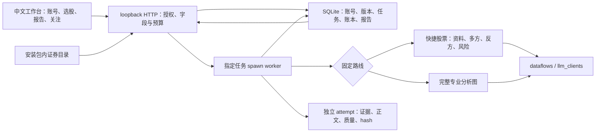
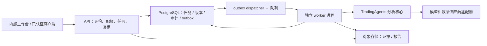

# 生产系统总体方案

状态：2026-10-25本机当前方案与生产目标。读者为架构/工程/SRE，架构责任角色维护，执行路线、存储或部署边界变更及每次合并前复核。事实来源是`application/`、`interfaces/api.py`、`infrastructure/`及验证记录，云组件尚未实现。依据[ADR-0001](adr/0001-modular-monolith.md)采用模块化单体与独立worker。

## 1. 本机当前系统

同一个Python服务提供静态React资源与JSON接口，监听127.0.0.1。密码账号以端口隔离cookie，任务固定配置和凭据revision引用；API不直接执行分析图。独立线程只负责启动并等待指定spawn任务，SQLite租约/预算守卫限制结果接受。演示会话使用独立数据库及脚本模型，真实路线不使用演示行情替代。

## 2. 生产目标边界（待建）

控制面选择 FastAPI + Pydantic；持久任务与审计选择 PostgreSQL；对象存储使用公司 S3 兼容服务；队列先选公司托管 Redis Streams（consumer group + pending reclaim），如公司已有标准队列则替换适配器。队列只承担投递，数据库是状态真相；消息允许至少一次交付。

这些云组件是候选目标，现有 Compose 不包含它们。本地实现直接从SQLite领取任务、存储hash固定文件，API仅127.0.0.1且不运行图；worker另起进程，不使用Redis/outbox。系统尚未具备云服务准入条件。

## 3. 逻辑分层与路径演进

| 层 | 当前复用 | 后续路径及责任 |
|---|---|---|
| 接口 | `src/cli/` | `src/tradingagents/interfaces/api/` 提供认证、DTO、HTTP；不直接调用行情库 |
| 应用 | graph、backtest、reporting | `application/` 承担任务、复核、评估用例及事务 |
| 领域 | agents schema、portfolio、rating | `domain/` 承担任务状态、策略版本、证据和预算契约；不依赖框架 |
| 研究核心 | agents、graph | 保留现有路径，逐步通过 application adapter 封装 |
| 基础设施 | llm_clients、dataflows、memory | `infrastructure/` 实现任务 repository、对象存储、队列、身份和观测适配器 |

当前路径为`interfaces/api.py`、`application/{runs,worker,service,guided_stock,securities,investor,model_probe}.py`、`domain/`及`infrastructure/`；真实快捷行情只在`dataflows/guided_stock.py`导入yfinance。`web/src/`编辑前端，构建输出随包安装至`tradingagents/web/`，证券资料在`assets/security-catalog.json`，资源查找不依赖仓库工作目录。旧graph依赖保持兼容，不宣称完整依赖倒置。

## 4. 一致性、幂等与执行

以下编号是云端目标。本地实际幂等键为 `(workspace, author, idem_key)`，相同输入复用，冲突400；条件领取/预算预留/完成在SQLite事务内，报告登记及访问审计是独立操作，并不宣称与任务同一事务原子提交。实验准入额外保证同一计划样本只有一个任务，取消不释放累计工作空间准入额度。

1. API 在同一事务创建任务、预算预留、审计与 outbox；唯一约束 `(workspace_id, idempotency_key)`，规范化请求哈希不同则409。
2. dispatcher 读取 outbox 投递队列，成功后标记；投递和标记间崩溃会重复消息，worker 通过数据库领取排除重复执行。
3. worker 原子领取 queued 或租约过期的任务，生成递增 attempt/fencing_token；心跳续租。供应商调用不能与数据库事务实现 exactly-once，重试可能产生额外费用。
4. 每个任务/attempt 使用独立 graph、配置与临时路径；不跨任务共享 graph 实例。同一任务只能有一个有效租约的 worker。
5. 对象上传到 attempt 专属路径，校验 hash 后，以状态版本及 fencing_token 条件更新接受结果。失效 attempt 可以留下孤立对象，清理任务延迟回收。
6. succeeded 与报告指针、审计、预算实际费用在事务中落库；禁止先报告成功后保存报告。失败返回可重试分类及已消耗费用。

## 5. 超时、预算、恢复

任务总 deadline 15分钟为生产建议值，本地TaskLimits默认1800秒。spawn父进程续租并在取消/超时后终止子进程；子进程自查租约。逐次模型调用前预留预算、SDK内部重试为0、总预算标志独立阻止结果接受；费用unknown待一次性账单对账。预留额不是实际价格，已发出的调用仍可能计费。

旧SDK checkpoint行为保留；托管attempt从新目录运行，冻结输入和实现指纹并在执行前后校验，不继承未接受的checkpoint或其他实验记忆。备份恢复校验固定hash、重定位副本路径、撤销凭据并取消副本的queued/running任务，不自动外部重跑。不把SQLite文件放在多副本共享网络盘。

快捷路线先收集真实OHLCV、基准、公司、新闻和所需FX，关键价格身份/币种/时效/范围错误时不付费生成判断。四个模型环节每个最多两次尝试，SDK重试0，总调用不超过8；提交前预算须容纳8次预留。实际输出使用模板token额度，截断或空结果归类而不冒充有效结论。部分结果保存为Insufficient报告，BudgetExceeded、LeaseLost及证据完整性失败继续传播。研究完整度、质量与复核状态分别保存。

证券目录是选择元数据，不含报价、不自动扩大权限；`allow_listed_stocks`只由可信模板授予。用户选中资料、研究意图、路线、显示货币进入冻结任务；报价按原币种，显示换算只从有效有日期的已留存FX计算。公司/新闻快照不认证历史公开时点，指标与叙述仍需复核。

## 6. 部署与容量

API 无状态，worker 按资源和供应商配额扩展。初期每进程单任务，worker 并发2为起点；分析师内部已有并行，应把工具与模型并发计入供应商配额。数据库连接池、对象写入和队列 backlog 各有上限，排队超过 SLO 触发扩容或拒绝。

单位任务成本近似 `Σ(input_tokens × input_price + output_tokens × output_price) + 数据费用`，包含重试与记忆反思；模型价格表需带版本。上线前按标的/分析师组合/辩论深度测量 p50/p95耗时、tokens、数据调用、费用及失败率。

## 7. 替代方案与权衡

全面微服务会增加接口、部署与分布式事务成本，现阶段职责与规模证据不足。单进程 Web 内运行 graph 会阻塞请求并放大上下文串扰。采用模块化单体保持统一契约，worker 以进程隔离耗时任务；未来只有明确团队、资源或扩展瓶颈才拆服务。

相关约束：[数据与接口](data-and-api.md)、[安全](security-model.md)、[监控](../06-runbooks/observability.md)、[实施计划](../03-development/implementation-plan.md)。
