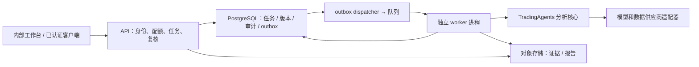

# 生产系统总体方案

状态：目标设计，尚未实现 API、队列、数据库与工作台。技术选型用于后续开发；当前可执行代码仍是 CLI/SDK。依据 [ADR-0001](adr/0001-modular-monolith.md) 先采用模块化单体与独立 worker 进程。

## 1. 系统边界

控制面选择 FastAPI + Pydantic；持久任务与审计选择 PostgreSQL；对象存储使用公司 S3 兼容服务；队列先选公司托管 Redis Streams（consumer group + pending reclaim），如公司已有标准队列则替换适配器。队列只承担投递，数据库是状态真相；消息允许至少一次交付。

这些组件是候选目标。不得在现有 Compose 中声称 API/DB 已可运行；平台实现前使用单机隔离 CLI 试运行。

## 2. 逻辑分层与路径演进

| 层 | 当前复用 | 后续路径及责任 |
|---|---|---|
| 接口 | `src/cli/` | `src/tradingagents/interfaces/api/` 提供认证、DTO、HTTP；不直接调用行情库 |
| 应用 | graph、backtest、reporting | `application/` 承担任务、复核、评估用例及事务 |
| 领域 | agents schema、portfolio、rating | `domain/` 承担任务状态、策略版本、证据和预算契约；不依赖框架 |
| 研究核心 | agents、graph | 保留现有路径，逐步通过 application adapter 封装 |
| 基础设施 | llm_clients、dataflows、memory | `infrastructure/` 实现任务 repository、对象存储、队列、身份和观测适配器 |

目标目录只在具体实现时创建；目前没有空模块冒充功能。现有 graph 直接依赖 dataflows、llm_clients、memory，尚未完全实现上述依赖倒置，应通过渐进封装迁移，避免重命名全部算法模块。

## 3. 一致性、幂等与执行

1. API 在同一事务创建任务、预算预留、审计与 outbox；唯一约束 `(workspace_id, idempotency_key)`，规范化请求哈希不同则409。
2. dispatcher 读取 outbox 投递队列，成功后标记；投递和标记间崩溃会重复消息，worker 通过数据库领取排除重复执行。
3. worker 原子领取 queued 或租约过期的任务，生成递增 attempt/fencing_token；心跳续租。供应商调用不能与数据库事务实现 exactly-once，重试可能产生额外费用。
4. 每个任务/attempt 使用独立 graph、配置与临时路径；不跨任务共享 graph 实例。同一任务只能有一个有效租约的 worker。
5. 对象上传到 attempt 专属路径，校验 hash 后，以状态版本及 fencing_token 条件更新接受结果。失效 attempt 可以留下孤立对象，清理任务延迟回收。
6. succeeded 与报告指针、审计、预算实际费用在事务中落库；禁止先报告成功后保存报告。失败返回可重试分类及已消耗费用。

## 4. 超时、预算、恢复

任务总 deadline 15分钟建议值；供应商 HTTP timeout、SDK retries、图轮次都是子预算，不能相互叠加绕过总时限。预算按调用前预留、返回后核销；unknown usage 保留估算并标记待对账。取消采用协作式检查，停止后续节点，保留已发出的调用。

现有 checkpoint 在成功时清除，且其签名包含图形状和设置；目标恢复同时冻结代码、prompt、依赖与 snapshot 版本。S1 先由单任务独立工作目录保护恢复，S2 评估集中 checkpoint 或同一 worker 亲和；不把 SQLite 文件放在多副本共享网络盘。

## 5. 部署与容量

API 无状态，worker 按资源和供应商配额扩展。初期每进程单任务，worker 并发2为起点；分析师内部已有并行，应把工具与模型并发计入供应商配额。数据库连接池、对象写入和队列 backlog 各有上限，排队超过 SLO 触发扩容或拒绝。

单位任务成本近似 `Σ(input_tokens × input_price + output_tokens × output_price) + 数据费用`，包含重试与记忆反思；模型价格表需带版本。上线前按标的/分析师组合/辩论深度测量 p50/p95耗时、tokens、数据调用、费用及失败率。

## 6. 替代方案与权衡

全面微服务会增加接口、部署与分布式事务成本，现阶段职责与规模证据不足。单进程 Web 内运行 graph 会阻塞请求并放大上下文串扰。采用模块化单体保持统一契约，worker 以进程隔离耗时任务；未来只有明确团队、资源或扩展瓶颈才拆服务。

相关约束：[数据与接口](data-and-api.md)、[安全](security-model.md)、[监控](../06-runbooks/observability.md)、[实施计划](../03-development/implementation-plan.md)。
